# Automotive BLE-to-CAN Communication Module

A small 4-layer board that sits on a vehicle's 12/24 V harness, talks CAN FD through a TCAN4550-Q1, and exposes it over Bluetooth LE through a CC2340R5-Q1. It runs from 9–36 V vehicle power with reverse-battery and load-dump protection, and rides through power loss on a 1S Li-ion backup cell. This is a **pre-fabrication design**: schematic, layout and manufacturing outputs are complete and pass KiCad ERC/DRC, but no board has been built or measured yet.

| Area | Implementation |
|------|----------------|
| MCU | TI CC2340R5-Q1 (CC2340R52E0WRHBRQ1, BLE 5.3, QFN32) |
| CAN | TI TCAN4550-Q1 (CAN FD controller + transceiver) |
| Vehicle input | 9–36 V, fused, TVS-clamped, ideal-diode reverse protection |
| Intermediate rail | 6.0 V (LM5164-Q1 buck) |
| Digital rail | 3.3 V (TPS62A01-Q1), shared by MCU and TCAN VIO |
| CAN interface | CAN / CAN FD, optional split 120 Ω termination |
| MCU ↔ CAN | SPI + nINT / RST / nWKRQ |
| Backup power | 1S Li-ion connector, BQ24074 charger / power path |
| RF | TI SWRU120D inverted-F PCB antenna, U.FL conducted-test option |
| Debug | 10-pin Cortex SWD + 28 test points |
| PCB | 80 × 60 mm, 4 layers, 1.6 mm, single-sided assembly |
| EDA | KiCad 10 |

## PCB Preview

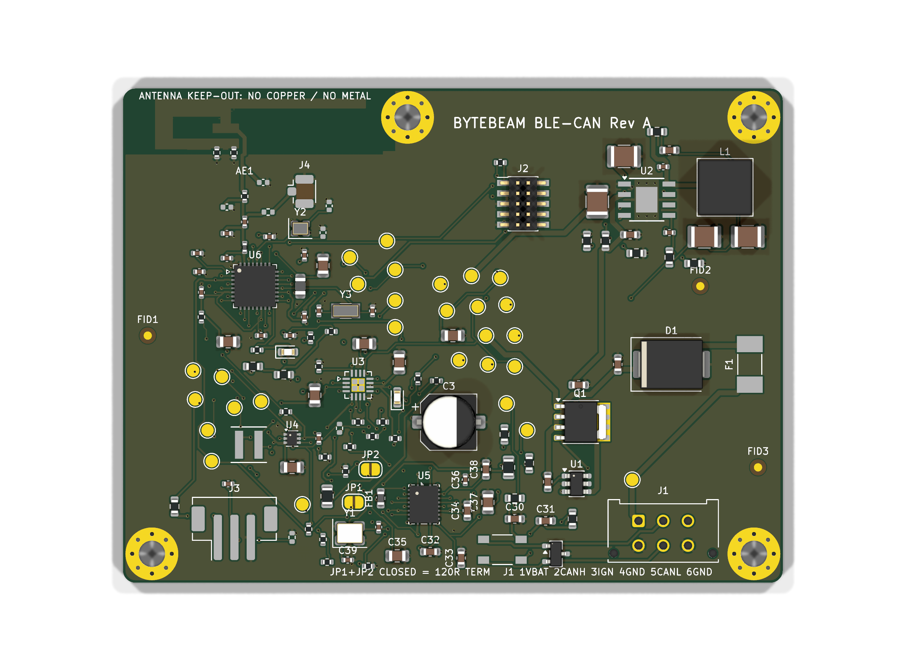

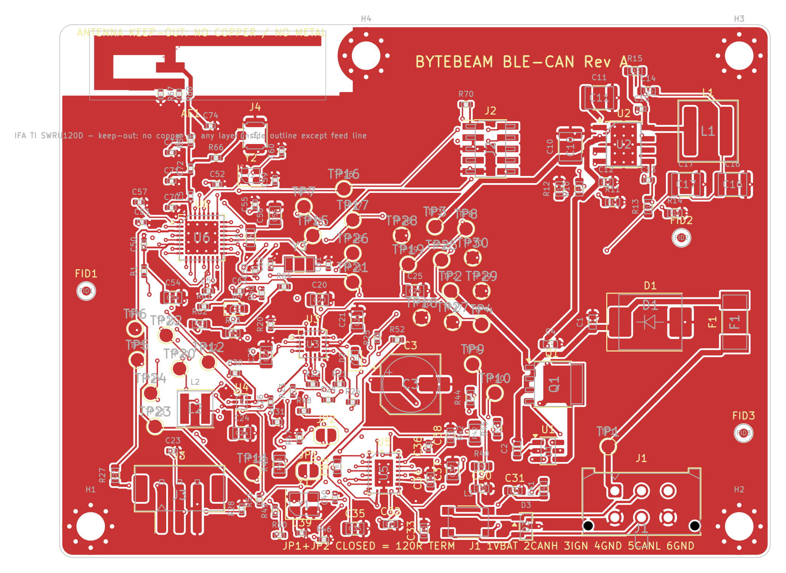

Full schematic: [schematic/schematic.pdf](schematic/schematic.pdf) · all copper layers: [schematic/pcb_layers.pdf](schematic/pcb_layers.pdf)

---

## Overview

The brief was a module that connects to a vehicle CAN bus and makes it reachable over BLE. The requirements that drove the design:

- 9–36 V vehicle input (12 V and 24 V systems), surviving reverse battery and a centrally suppressed load dump
- CAN / CAN FD using the TCAN4550, with bus protection and a termination strategy
- BLE using a CC2340-family automotive part
- A backup battery so the MCU and radio stay alive through crank and brief power loss
- SPI between the BLE MCU and the CAN controller
- Programming/debug access and test access for bring-up and production
- A layout that is DRC-clean and ready to send to a 4-layer fab

## My Role

This was my project end to end at the design-package level: system architecture, part selection against datasheets, the six-sheet hierarchical schematic, PCB placement/routing and stackup choice, test and debug access, BOM, DFMEA, power budget, validation plan, and the Gerber/drill/assembly outputs. I used AI-assisted tooling during development (including scripted generation of parts of the KiCad schematic and the routing); I directed and reviewed that work against the datasheets and the KiCad checks, and I'm responsible for the design decisions described here.

## System Architecture

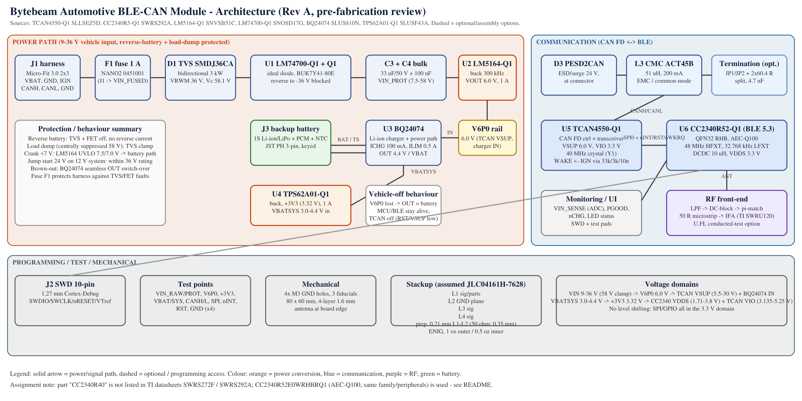

Power comes in on J1 (Molex Micro-Fit 3.0, 2×3), which also carries CANH/CANL and an ignition line. The vehicle supply goes fuse → TVS → ideal diode → 6.0 V buck. The 6.0 V rail feeds the TCAN4550's VSUP directly and also feeds the BQ24074 power-path charger; the charger's output (vehicle-derived or from the battery) feeds a 3.3 V buck that powers the CC2340 and the TCAN4550's logic I/O. The CC2340 talks to the TCAN4550 over SPI0 plus interrupt, reset and wake lines. The antenna is at the top-left board edge, the vehicle connector at the bottom-right.

## Power Architecture

```
J1 VBAT 9–36 V
 └─ F1 1 A fuse ─ D1 SMDJ36CA TVS ─ U1 LM74700-Q1 + Q1 BUK7Y41-80E (ideal diode)
     └─ VIN_PROT (33 µF/50 V bulk)
         └─ U2 LM5164-Q1 buck, ~300 kHz, UVLO 7.5 V / 7.0 V ──► V6P0 = 6.0 V
             ├─ FB1 ─► TCAN4550 VSUP
             └─ U3 BQ24074 IN ──► VBATSYS (4.4 V, or battery) ◄─► J3 1S Li-ion
                   └─ U4 TPS62A01-Q1 ──► +3V3 (3.32 V) ─► CC2340 VDDS, TCAN VIO
```

- **Reverse polarity:** an LM74700-Q1 driving an 80 V N-FET instead of a series Schottky. It blocks a reversed battery (to −36 V) without the ~0.5 V forward drop and heat of a diode. I picked the BUK7Y41-80E (standard-level) over the logic-level BUK9Y41 because the logic-level part's V<sub>GS</sub> rating doesn't cover the controller's gate drive.
- **Transients:** the SMDJ36CA (V<sub>RWM</sub> 36 V, V<sub>C</sub> ≤ 58.1 V) sits right after the fuse. The design assumes the vehicle has central load-dump suppression (ISO 16750-2 test B), so the clamped node stays inside the LM74700 (65 V abs), FET (80 V) and LM5164 (100 V) ratings.
- **Buck:** the LM5164-Q1 handles the full input range with margin; its UVLO divider (7.5 V rising / 7.0 V falling) cleanly hands over to the battery during cranking instead of letting the rail droop.
- **High-voltage nets** (VIN_RAW/FUSED/PROT, SW, gate) are in their own net class with 0.3 mm clearance.

Full set-point math, load budget and calculated thermal numbers are in [documentation/POWER_BUDGET.md](documentation/POWER_BUDGET.md).

## CAN / CAN FD

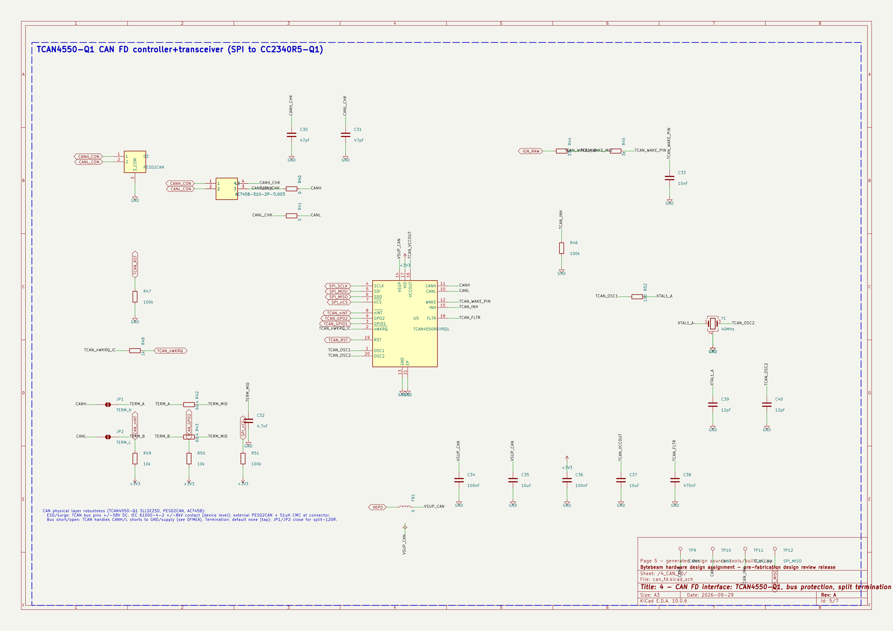

- **TCAN4550-Q1** integrates the CAN FD controller and transceiver, so the CC2340 (which has no CAN peripheral) only needs SPI: SCLK DIO8, CSN DIO11, POCI DIO12, PICO DIO13, plus nINT (DIO14), RST (DIO18), nWKRQ (DIO19).
- **Clock:** 40 MHz crystal with 100 Ω series on OSC1.
- **Bus protection** at the connector: PESD2CAN ESD diode, then a TDK ACT45B common-mode choke, then 47 pF line caps, then 0 Ω links (R40/R41) that can be swapped for series damping.
- **Termination:** split termination, 2 × 60.4 Ω with a 4.7 nF midpoint cap to GND, connected through solder jumpers JP1/JP2. Default open, because a plug-in module is usually a bus *tap*, not an end node. Closing both jumpers makes it a 120 Ω end node on the bench. The silkscreen says so next to the jumpers.
- **Wake:** ignition line into WAKE through the TCAN datasheet's 33 k / 3 k / 10 nF network; INH has a 100 k pull-down.
- **nWKRQ:** this pin defaults to the TCAN's internal 3.6 V rail, which is above the CC2340's 3.3 V I/O. A 1 k series resistor limits current into the MCU pin until firmware switches nWKRQ to VIO (register 0x0800 bit 19).

## BLE / MCU

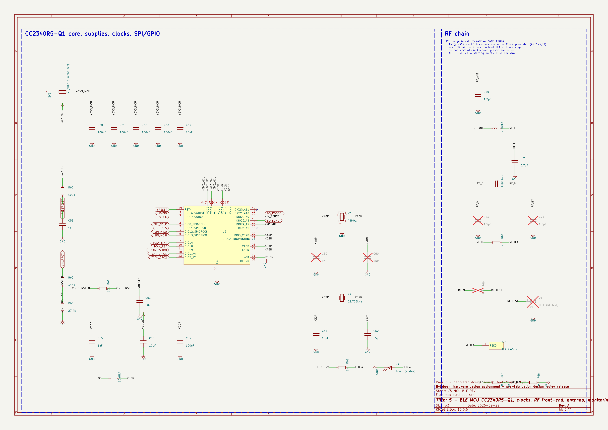

- **Part:** CC2340R52E0WRHBRQ1 (CC2340R5-Q1, AEC-Q100). The brief named "CC2340R40", which I couldn't find in TI's documentation, so I used the closest automotive family member and flagged it.
- **Clocks:** 48 MHz crystal (TZ3908AAAO43, the part TI validates) and 32.768 kHz crystal for sleep timing.
- **Supply:** 100 nF per VDDS pin, internal DC/DC with 10 µH + 10 µF on VDDR as TI requires, 1 µF on VDDD.
- **RF:** LPF → DC block → π-match → 0.40 mm 50 Ω microstrip → TI SWRU120D inverted-F antenna at the board edge, with a copper keep-out on all four layers. Matching values are TI reference starting values, not tuned.
- **Debug:** SWDIO DIO16, SWDCK DIO17, nRESET to the SWD header.

## Backup Battery

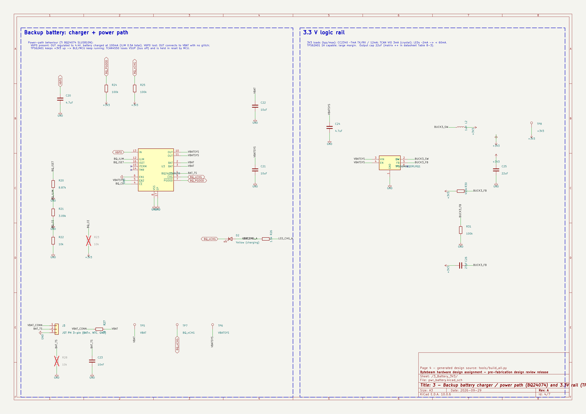

J3 is a keyed JST PH 3-pin (BAT+, NTC, GND) for a protected 1S Li-ion pack with a 10 k NTC. The BQ24074 charges at 100 mA (R<sub>ISET</sub> 8.87 k) with a ~0.5 A input limit, and its power-path output switches from the 6.0 V input to the battery when vehicle power drops. Intended behavior during crank or power loss: the CC2340 and radio stay up on the battery, the TCAN4550 loses VSUP and has to be re-initialized by firmware when power returns. That behavior is designed from the datasheets, **not** tested.

## PCB Layout

| Top 3D | Bottom 3D |
|---|---|
|  | 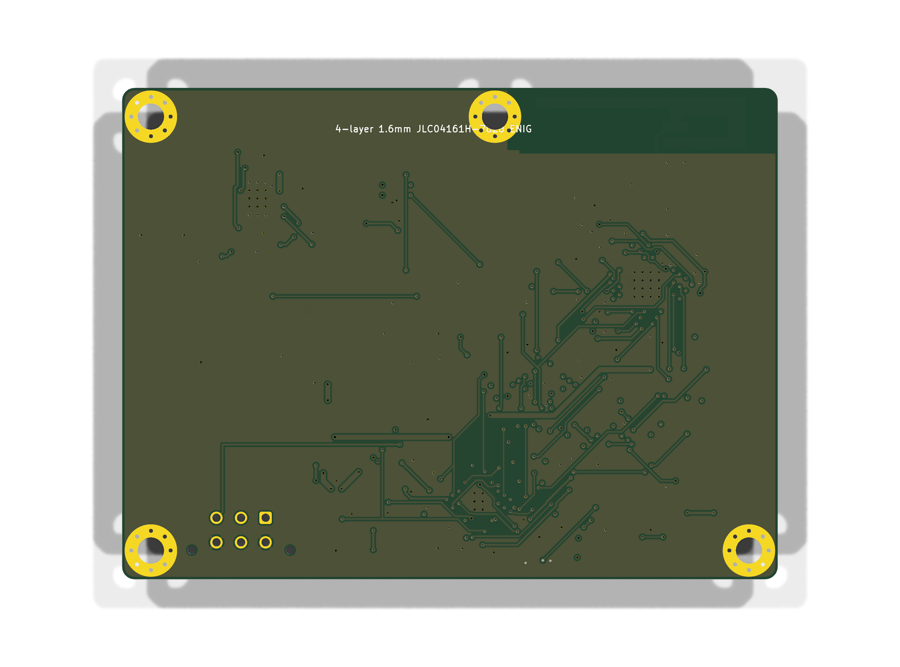 |

| L1 F.Cu | L2 In1 (GND) | L3 In2 | L4 B.Cu |
|---|---|---|---|
| 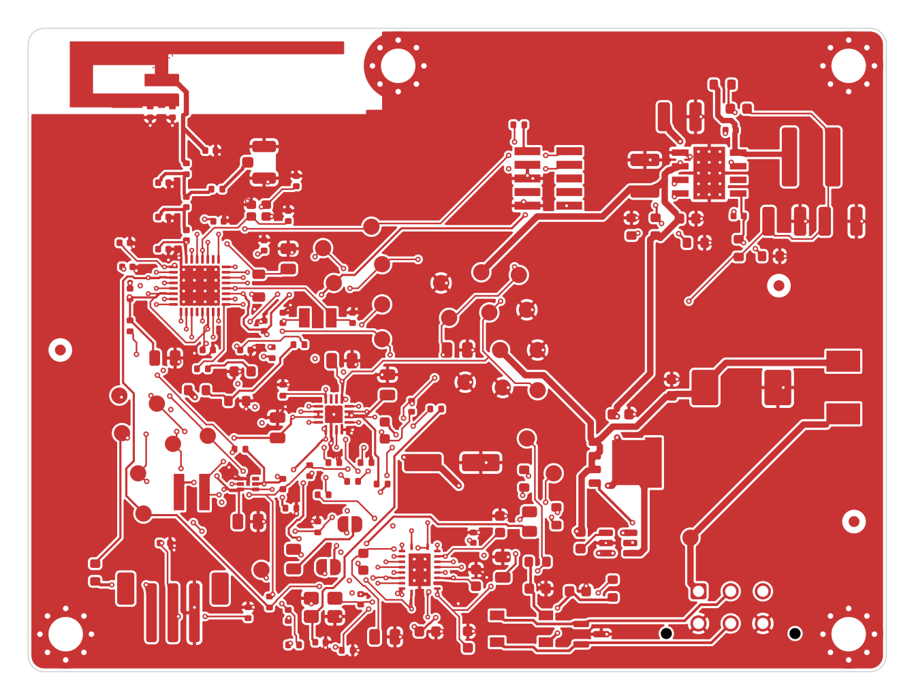 | 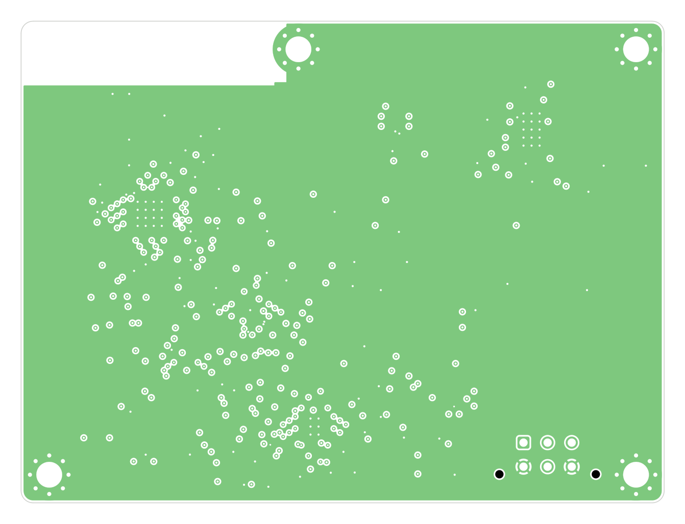 | 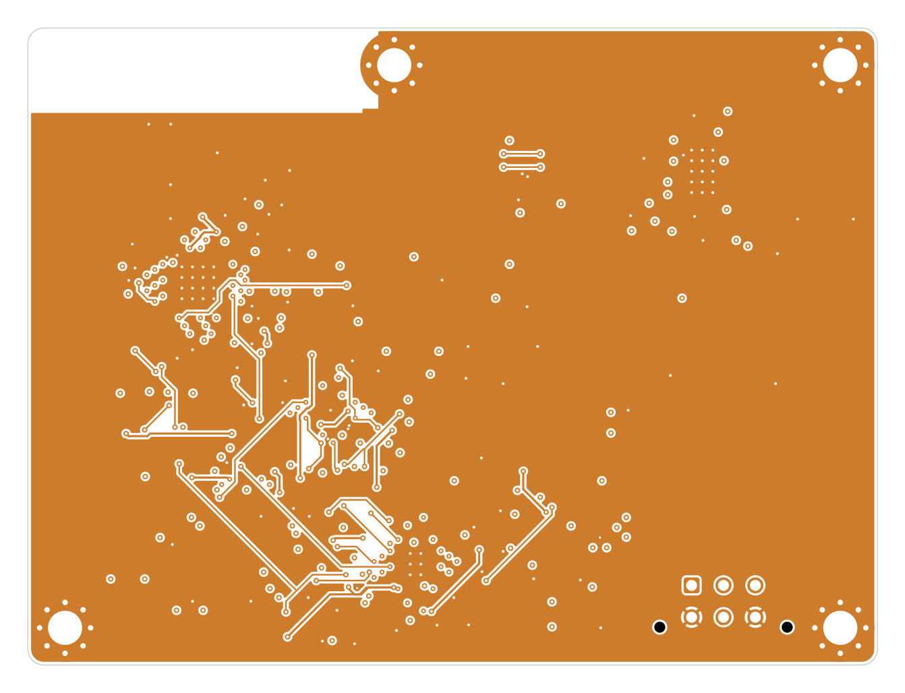 | 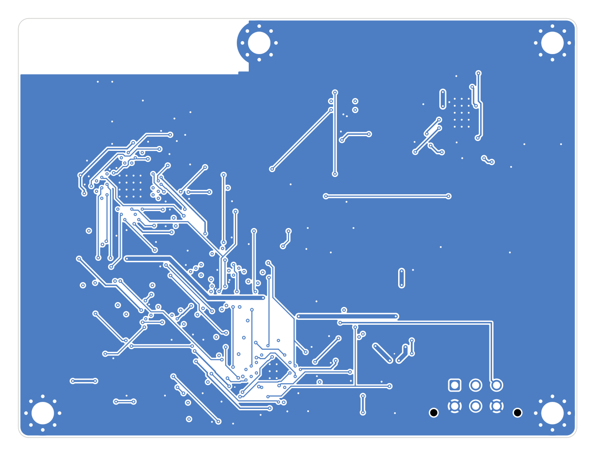 |

- **Stackup:** F.Cu signals + RF / In1 solid GND / In2 signals + power / B.Cu routing, GND pours on all layers. Assumes a JLC04161H-7628 style stackup (0.21 mm prepreg to In1), which sets the 0.40 mm microstrip width. Details: [documentation/STACKUP_AND_LAYOUT.md](documentation/STACKUP_AND_LAYOUT.md).
- **Zoning:** antenna top-left with keep-out; CC2340 just below it with the RF chain in a straight line to the feed; power input on the right edge (fuse, TVS, ideal diode in a row) with the buck top-right and a tight CIN–U2–L1–COUT loop; vehicle connector J1 bottom-right with CAN ESD and CMC directly next to it; TCAN4550 between J1 and the MCU to keep SPI short; battery connector bottom-left, away from the antenna.
- **Ground:** every GND pad gets a via to In1, via arrays under the thermal pads, four plated M3 holes tied to GND.
- **Assembly:** all parts on the top side, 3 fiducials, single reflow pass.

## Design Highlight: one 6.0 V rail doing three jobs

**Problem.** The TCAN4550 needs VSUP ≥ 5.5 V. Its internal LDO burns (VSUP − 5 V) × ~80 mA whenever the bus is driven, so feeding it straight from a 24–36 V vehicle input would dissipate a lot of heat in a small QFN (the datasheet's thermal-shutdown example is at 20 V). Meanwhile, the BLE side needs a battery-backed 3.3 V rail, and the charger that provides it has its own input window (BQ24074 OVP at 10.5 V).

**Obvious alternatives.** Run VSUP from the protected vehicle rail (simple, hot at 24 V+), or build a 5 V rail (below TCAN's 5.5 V minimum), or add a separate rail for the charger.

**What I did.** One LM5164 buck set to 6.0 V (1.2 V × (1 + 200 k / 49.9 k) = 6.01 V). That single number satisfies three constraints at once:

1. above TCAN VSUP minimum (5.5 V) with margin for tolerance and the FB1 ferrite drop,
2. low enough that the TCAN's internal LDO dissipates roughly 1 V × load rather than 20–30 V × load,
3. inside the BQ24074's input range, so the same rail also feeds the charger/power path, which then makes the 3.3 V rail for the MCU **and** the TCAN VIO pin.

**Payoff.** Both chips share one 3.3 V logic domain, so SPI/interrupt/reset need no level shifters. The CAN transceiver's heat is decoupled from the vehicle voltage. The battery path only has to back up the low-power 3.3 V domain, while the power-hungry CAN supply simply drops out during a crank and gets re-initialized, which is fine for a bus tap. It's one regulator and two resistors, instead of a 5 V rail plus a separate charger supply plus level translation.

A smaller detail in the same spirit: the IFA antenna's two grounded shorting tabs are connected through 0 Ω links (R67/R68), and the feed has a 0 Ω steering pair (R65 fitted / R66 DNP) to a U.FL connector. That makes the antenna's DC short and the conducted-RF path reconfigurable with a soldering iron during RF tuning, without a board respin.

## Design Verification (in KiCad, not on hardware)

Run with KiCad 10.0.6 `kicad-cli` on the delivered files ([reports](manufacturing/reports/)):

- **ERC:** 0 errors, 0 warnings.
- **DRC:** 0 errors, 0 unconnected items, 0 schematic-parity issues. 45 warnings remain:
  - 23 `via_dangling`: vias connected on only one layer (including some on signal nets such as SPI_nCS, nRESET, X32P, VBATSYS left over from routing). They don't break connectivity but should be cleaned up before fab.
  - 2 `hole_to_hole`: these are routing vias, not mounting holes or intentional mechanical features. Two GND vias at (52.5, 60.1) / (52.6, 59.8) mm have only 0.078 mm drill-to-drill spacing, and two TCAN_GPO2 vias at (56.8, 75.0) / (57.2, 75.1) mm have 0.193 mm, against a 0.2 mm rule. Each pair is on the same net, so there's no electrical short, but the 0.078 mm pair is a real fabrication risk (drill breakout). **Fix before ordering** by deleting or moving one via of each pair.
  - 20 silkscreen overlap / silk-over-copper from stock footprint outlines.
- The copper-zone fill saved in the board file was stale: run without refilling zones, DRC flags two IGN_RAW tracks touching the B.Cu GND pour. I refilled the zones (no tracks, footprints or nets changed), re-ran DRC, and regenerated the Gerbers, drill and assembly outputs from the refilled board, so the fab files match the clean DRC result.
- Symbol-pin vs footprint-pad check and BOM-vs-netlist cross-check (all references match).
- Pinouts and key values traced to datasheets: [documentation/DATASHEET_TRACE.md](documentation/DATASHEET_TRACE.md).

## Manufacturing Outputs

| File | Content |
|---|---|
| [manufacturing/gerbers.zip](manufacturing/gerbers.zip) | 4 copper layers, mask, paste, silkscreen, edge cuts, Gerber job file |
| [manufacturing/drill_files.zip](manufacturing/drill_files.zip) | Excellon drill + drill map |
| [bytebeam_pos_front.csv](manufacturing/assembly_outputs/bytebeam_pos_front.csv) | pick-and-place (top side) |
| [bytebeam.d356](manufacturing/assembly_outputs/bytebeam.d356) | IPC-D-356 netlist for bare-board test |
| [bytebeam_ipc2581.xml](manufacturing/assembly_outputs/bytebeam_ipc2581.xml) | IPC-2581 |
| [bytebeam_netlist.xml](manufacturing/assembly_outputs/bytebeam_netlist.xml) | KiCad netlist |
| [bytebeam.step](manufacturing/assembly_outputs/bytebeam.step) | 3D STEP model (a few connector/fuse 3D models were missing at export) |
| [documentation/BOM.csv](documentation/BOM.csv) | BOM with MPN, ratings, AEC qualification, alternatives, open assumptions |
| [schematic/assembly_top.pdf](schematic/assembly_top.pdf) | top assembly drawing |

## Debug / Bring-Up Considerations

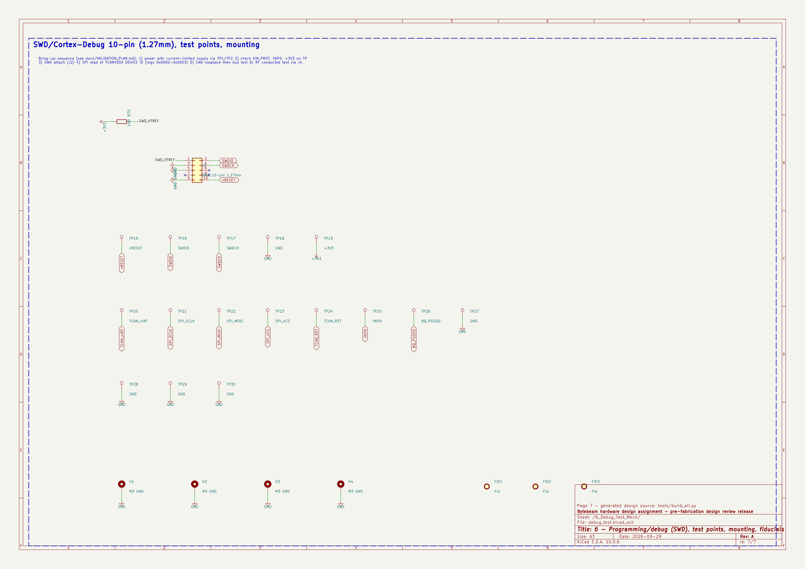

I laid out the test access in the order I'd bring the board up:

1. **Power, stage by stage, with a current-limited supply.** Test points on every rail along the chain: VIN_RAW (TP1) → VIN_FUSED (TP2) → VIN_PROT (TP3) → V6P0 (TP4/TP25) → VBAT (TP5) / VBATSYS (TP6) → +3V3 (TP8/TP19), plus BQ_PGOOD (TP26) and BQ_nCHG (TP7). If a rail is missing, the fault is between two adjacent test points. Five GND test points spread over the board for scope grounds.
2. **MCU alive.** 10-pin Cortex SWD header (J2) for an XDS110/J-Link, and SWDIO/SWDCK/nRESET are also on test pads (TP16/TP17/TP15) for a pogo-pin fixture in production. A blinky LED is on a DIO.
3. **SPI to the TCAN.** SCLK, MOSI, MISO, nCS, nINT and TCAN_RST all on test points (TP21/22/12/23/20/24), so a logic analyzer can decode the first device-ID read (registers 0x0000–0x0003) without probing a 0.5 mm QFN.
4. **CAN.** CANH/CANL test points (TP9/TP10), TCAN_INH (TP11), and the termination jumpers so the board can be an end node on a two-node bench bus.
5. **RF.** Fit R66 / remove R65 to route the radio to the U.FL connector (J4) for conducted power and harmonics on a spectrum analyzer, then reverse it for antenna S11 on a VNA.

Full step-by-step plan: [documentation/VALIDATION_PLAN.md](documentation/VALIDATION_PLAN.md).

## What Still Needs Physical Validation

Nothing has been fabricated, powered or measured. All of the following are open:

- Fix the two `hole_to_hole` via pairs and clean up the dangling vias before fab
- RF matching network tuning (values are TI reference starting points; topology needs confirming against the LP-EM-CC2340R5-Q1 design files)
- Antenna performance on this stackup and in an enclosure (S11, efficiency, range)
- 50 Ω microstrip impedance with the fab's real dielectric data
- Crystal load values (TCAN 40 MHz caps are assumptions)
- EMC/EMI (CISPR 25; the 300 kHz buck lands in the AM band), ESD (IEC 61000-4-2 / ISO 10605)
- Transients: ISO 7637-2 pulses, ISO 16750-2 load dump, reverse battery, cranking profile
- Thermal performance (current numbers are datasheet θ<sub>JA</sub> estimates)
- CAN signal integrity and FD bit timing (CANH/CANL are routed as two nets, not a coupled pair)
- Battery charging, power-path handover and sleep current
- Land patterns for Coilcraft XGL inductors and the 48 MHz crystal against vendor drawings
- BQ24074 is not AEC-Q100 qualified; an automotive-qualified charger would be needed for production
- Board bring-up and firmware

Design risks and mitigations are tracked in the [DFMEA](documentation/DFMEA.csv) (33 failure modes).

## Design Files

- Schematic: [schematic/schematic.pdf](schematic/schematic.pdf) and per-sheet images in [images/](images/)
- PCB layer plots: [schematic/pcb_layers.pdf](schematic/pcb_layers.pdf)
- KiCad project: [design_files/](design_files/) (open `bytebeam_ble_can.kicad_pro` in KiCad 10; custom symbols/footprints in `design_files/lib/`)
- BOM: [documentation/BOM.csv](documentation/BOM.csv)
- DFMEA: [documentation/DFMEA.csv](documentation/DFMEA.csv)
- Power budget: [documentation/POWER_BUDGET.md](documentation/POWER_BUDGET.md)
- Stackup and layout notes: [documentation/STACKUP_AND_LAYOUT.md](documentation/STACKUP_AND_LAYOUT.md)
- Validation plan: [documentation/VALIDATION_PLAN.md](documentation/VALIDATION_PLAN.md)
- Manufacturing outputs: [manufacturing/](manufacturing/)

Originally done as a hardware design assignment for Bytebeam; the board silkscreen still carries that name.

## Tools and Skills

KiCad 10 (schematic capture, 4-layer PCB layout, DRC/ERC, fab outputs) · automotive power electronics (protection, buck regulation, power path) · CAN / CAN FD · SPI · BLE · RF layout · DFMEA · Python for calculations and output generation
